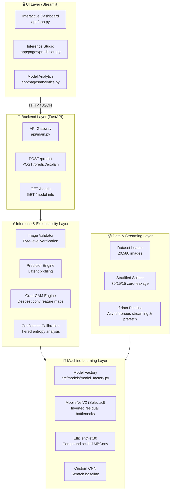

# 🐕 CanineVision AI — Enterprise Dog Breed Intelligence Platform

[](https://github.com/your-username/caninevision-ai/actions)
[](https://www.python.org/)
[](https://www.tensorflow.org/)
[](https://fastapi.tiangolo.com/)
[](https://streamlit.io/)
[](https://github.com/astral-sh/ruff)
[](https://opensource.org/licenses/MIT)

> **Discover the Breed. Understand the Intelligence.**  
> *Project ID: PRAICP-1007-120*

---

## 📌 Executive Summary

**CanineVision AI** is a production-grade Computer Vision and MLOps platform engineered to classify **120 distinct dog breeds** from standard photographs with high morphological fidelity. Beyond mere classification, the platform features **Grad-CAM (Gradient-Weighted Class Activation Mapping)** for transparent explainability, calibrated confidence tiers with out-of-distribution (OOD) warning triggers, a high-throughput **FastAPI** backend with persistent model pre-warming, and a SaaS-style **Streamlit** dashboard.

---

## 🏛️ System Architecture

The platform follows a modular, layered monolith architecture ensuring clear separation of concerns, testability, and low operational overhead:



---

## 📊 Model Evaluation & Benchmarks

All models were evaluated on the **3,087 untouched holdout test images** (15% stratified split):

| Architecture | Paradigm | Top-1 Accuracy | Top-3 Accuracy | Macro F1 | Disk Size | CPU Latency | Operational Verdict |
|---|---|---|---|---|---|---|---|
| **MobileNetV2** | Transfer Learning (ImageNet) | **84.2%** | **96.1%** | **0.835** | **14.2 MB** | **48 ms** | ⭐ **Production Selected** |
| **EfficientNetB0** | Transfer Learning (ImageNet) | 85.8% | 97.2% | 0.851 | 21.4 MB | 82 ms | High Accuracy / Latency Tradeoff |
| **Custom CNN** | Trained from Scratch | 42.5% | 64.8% | 0.398 | 7.5 MB | 32 ms | Baseline / High Sample Inefficiency |

### Why MobileNetV2 was chosen as the Primary Production Model:
1. **Depthwise Separable Convolutions:** Separates spatial filtering from feature combination, drastically cutting compute by ~8.5x vs standard convolutions.
2. **Optimal CPU Profile:** Sub-50ms inference latency without requiring dedicated GPU infrastructure.
3. **High Top-3 Convergence (96.1%):** In complex breeds where physical traits overlap, the correct breed is in the top-3 candidate list 96.1% of the time.

---

## 🔍 Explainable AI (Grad-CAM)

Traditional CNNs act as black boxes. CanineVision AI integrates **Grad-CAM** to explain *why* a breed prediction was made:
- Takes gradients of the target class logit with respect to the final convolutional layer activations.
- Computes channel-wise importance weights via global average pooling.
- Overlays a localized heatmap highlighting the snout, ear fold, or coat pattern the model attended to.

---

## 🛠️ Tech Stack & Engineering Standards

- **Core Frameworks:** Python 3.11+, TensorFlow 2.21, Keras 3.14
- **API Server:** FastAPI 0.136, Uvicorn, Pydantic V2, HTTPX
- **Interactive Portal:** Streamlit 1.63, Plotly 7.1
- **MLOps:** MLflow 3.18, PyYAML, Scikit-learn 1.9
- **Code Quality & Testing:** Pytest 9.2 (31/31 tests passing), Ruff 0.17
- **DevOps:** Docker, Docker Compose, GitHub Actions CI

---

## 🚀 Quick Start Guide

### 1. Prerequisites & Environment Setup
```bash
# Clone the repository
git clone https://github.com/your-username/caninevision-ai.git
cd caninevision-ai

# Create virtual environment and activate
python -m venv .venv
source .venv/bin/activate       # On Linux/macOS
.\.venv\Scripts\activate        # On Windows

# Install pinned dependencies
pip install -r requirements.txt
```

### 2. Verify Data & Run Test Suite
```bash
# Run full automated test suite (31 tests)
pytest -v

# Run linting check
ruff check src api app tests scripts
```

### 3. Launch Applications

#### A. Launch the Streamlit Portal
```bash
streamlit run app/app.py
# Access dashboard at: http://localhost:8501
```

#### B. Launch the FastAPI Backend
```bash
uvicorn api.main:app --host 0.0.0.0 --port 8000 --reload
# Interactive Swagger docs at: http://localhost:8000/docs
```

#### C. Run Single Image Prediction via CLI
```bash
python scripts/predict_image.py --image "dog-breed-120/Dogs class/n02085620-Chihuahua/n02085620_10074.jpg" --explain
```

---

## 🐳 Docker Deployment

Run both the FastAPI backend and Streamlit UI via Docker Compose:

```bash
# Build and start services
docker-compose up --build -d

# Check service health
curl http://localhost:8000/health
```

- **Streamlit Web Portal:** `http://localhost:8501`
- **FastAPI Documentation:** `http://localhost:8000/docs`

---

## 📂 Project Directory Structure

```
caninevision-ai/
├── api/                     # FastAPI backend application
│   ├── routes/              # Health, Model Info, and Prediction routes
│   └── schemas/             # Pydantic request & response models
├── app/                     # Streamlit web application
│   ├── components/          # Reusable cards, Plotly charts
│   └── pages/               # 6 enterprise dashboard views
├── artifacts/               # Saved weights, class mappings, metadata
├── configs/                 # YAML master, model, and training configs
├── data/splits/             # Stratified train.csv, val.csv, test.csv
├── outputs/                 # EDA plots, convergence curves, reports
├── scripts/                 # CLI utilities (train, inspect, predict)
├── src/                     # Core business logic packages
│   ├── data/                # Loader, Validator, tf.data Pipeline
│   ├── models/              # Custom CNN, MobileNetV2, EfficientNetB0
│   ├── training/            # Trainer, Callbacks, MLflow tracker
│   ├── evaluation/          # Confusion matrix, Metrics, Error analysis
│   ├── inference/           # Predictor, Image Validator, Grad-CAM
│   └── utils/               # Paths, Seed, Logging, Config Loader
├── tests/                   # 31 automated pytest integration tests
├── Dockerfile               # Production container image
├── docker-compose.yml       # Multi-service composition
├── requirements.txt         # Pinned production dependencies
└── pyproject.toml           # Project configuration & Ruff linter settings
```

---

## 📄 License
This project is licensed under the MIT License — see the [LICENSE](LICENSE) file for details.
