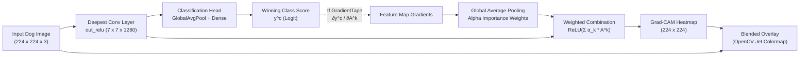

# Explainable AI (XAI) — Grad-CAM Technical Documentation
**Project Name:** Dog Breeds Classification  
**Project ID:** PRAICP-1007-120  
**Methodology:** Gradient-Weighted Class Activation Mapping (Grad-CAM)  

---

## 1. Overview & Objective

Deep neural networks are traditionally treated as "black boxes" because their final predictions emerge from millions of non-linear matrix multiplications. In a high-stakes classification application, users and domain experts need to know **why** a model predicted "Siberian Husky" rather than "Alaskan Malamute".

**Grad-CAM** provides visual transparency by generating a coarse 2D activation heatmap that highlights the discriminative image regions the convolutional network focused on to make its prediction.

---

## 2. Mathematical Foundation

Grad-CAM uses the gradient information flowing into the final convolutional layer of the CNN to assign an importance weight to each activation map.

### Step-by-Step Derivation:
1. **Target Score Computation:** Let $y^c$ be the raw class prediction score (before or after softmax) for breed class $c$.
2. **Gradient Flow:** Using `tf.GradientTape()`, we compute the partial derivatives of $y^c$ with respect to each feature map activation $A^k$ of the final convolutional layer:
   $$\frac{\partial y^c}{\partial A_{i,j}^k}$$
3. **Neuron Importance Weights ($\alpha_k^c$):** We global-average-pool the gradients across spatial dimensions (width $i$ and height $j$):
   $$\alpha_k^c = \frac{1}{Z} \sum_{i=1}^u \sum_{j=1}^v \frac{\partial y^c}{\partial A_{i,j}^k}$$
   where $Z = u \times v$ is the spatial area ($7 \times 7 = 49$).
4. **Weighted Linear Combination & ReLU:** We compute the weighted sum of feature maps and pass it through a Rectified Linear Unit ($\text{ReLU}$):
   $$L_{\text{Grad-CAM}}^c = \text{ReLU}\left(\sum_k \alpha_k^c A^k\right)$$
   *Why ReLU?* We only care about features that positively contribute to the target breed $c$. Pixels that decrease the score belong to competing breeds and are discarded.

---

## 3. Visual Interpretation Guide

The raw heatmap is normalized to $[0.0, 1.0]$, colorized using the standard **Jet Colormap**, and blended over the original photograph ($\alpha = 0.45$):

- 🔴 **Red / Yellow Regions (High Activation):** Areas that most strongly caused the neural network to predict the target breed. Typically focused on distinctive canine morphology:
  - Muzzle, jaw structure, and teeth (e.g. Bulldog underbite).
  - Ear shape and erectness (e.g. German Shepherd pointed ears vs. Basset Hound droopy ears).
  - Eye placement and facial masking (e.g. Siberian Husky eye masks).
  - Coat patterns and hair texture.
- 🔵 **Blue / Purple Regions (Low / Neutral Activation):** Irrelevant background areas (grass, carpet, sky, human handlers, leashes) that did not influence the decision.

---

## 4. Critical Technical Limitations (Interview Discussion)

> [!WARNING]
> A Grad-CAM heatmap is an **approximate visual attribution**, NOT proof of biological canine understanding.

1. **Spatial Coarseness ($7 \times 7$ Grid):** In MobileNetV2, the final feature map before pooling has dimensions of only $7 \times 7$ pixels. Upsampling a $7 \times 7$ grid to $224 \times 224$ via bilinear interpolation creates smooth, broad highlights rather than sharp pixel boundaries.
2. **Correlation vs. Causation:** If training images of Golden Retrievers frequently show dogs playing in water or grass, the network may learn to associate aquatic backgrounds with the breed. Grad-CAM exposes this failure mode by highlighting the pond rather than the dog!
3. **Identical Sister Breeds:** For nearly identical breeds (e.g., Norfolk vs. Norwich Terrier), Grad-CAM heatmaps for both breeds may look indistinguishable because both focus on the same facial region.

---

## 5. Generated Visual Artifacts

The explainability pipeline generated side-by-side comparison charts for verified test breeds:
- [outputs/gradcam/gradcam_Chihuahua_sample.png](../outputs/gradcam/gradcam_Chihuahua_sample.png)
- [outputs/gradcam/gradcam_German_shepherd_sample.png](../outputs/gradcam/gradcam_German_shepherd_sample.png)
- [outputs/gradcam/gradcam_golden_retriever_sample.png](../outputs/gradcam/gradcam_golden_retriever_sample.png)
- [outputs/gradcam/gradcam_Samoyed_sample.png](../outputs/gradcam/gradcam_Samoyed_sample.png)
- [outputs/gradcam/gradcam_Siberian_husky_sample.png](../outputs/gradcam/gradcam_Siberian_husky_sample.png)
